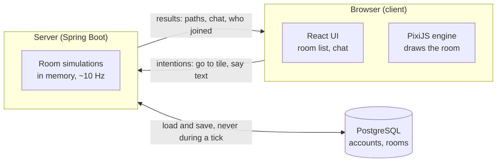

# Architecture

open-iso-world is a small multiplayer game: players walk on an isometric tile grid, see each other move and chat. This page explains how the pieces fit together. The decisions behind them live in [`docs/adr/`](adr/).

## The big picture



The browser asks, the server decides, the database remembers. Live state (who is where, what was said) never touches the database.

Three rules shape everything else:

1. **The server has the last word.** The client only sends intentions ("go to this tile", "say this"). The server validates them, decides what happens and tells everyone.
2. **The server thinks in grid coordinates.** Tiles are `(x, y)`. Isometric projection and screen pixels exist only in the client's `engine`.
3. **One protocol.** Every message is defined once in `protocol/` as JSON Schema. TypeScript types and Java records are generated from it, so client and server can't drift apart.

## A move, end to end

```text
1. Player clicks a tile        engine/input turns the click into (x, y)
2. Client sends intention      { "type": "move_to", "seq": 12, "payload": { "x": 4, "y": 7 } }
3. Server queues the command   net puts it in the room's command queue
4. Next tick (~100 ms)         core validates the tile, rate-limits, runs A* around blocked tiles
5. Server broadcasts the path  { "type": "path", "payload": { "player_id": "...", "tiles": [[3,7],[4,7]] } }
6. Every client animates it    game interpolates tile by tile, engine draws it depth-sorted
```

The server sends the **whole path once**, not a position every tick. Clients animate on their own, which keeps traffic small and movement smooth.

## Connecting

```text
POST /api/tickets   →  { "ticket": "…" }        (single use, expires in seconds)
WS   /ws?ticket=…   →  hello { protocol_version } → welcome + room_state
```

Every player gets a ticket first, guests included. Today the server issues it to an anonymous guest. From v0.3 it can also issue one to a logged-in account. The WebSocket side doesn't change, and access tokens never appear in URLs or logs.

## Server

```text
app  ──►  net  ──►  core  ◄──  persistence
 │                   ▲              ▲
 └───────────────────┴──────────────┘
```

| Module        | What it does                                                    | Knows about           |
|---------------|-----------------------------------------------------------------|-----------------------|
| `core`        | Rooms, grid, pathfinding, tick loop, chat rules                 | Plain Java only       |
| `net`         | WebSocket sessions, decoding messages into room commands        | `core`, protocol      |
| `persistence` | JPA entities, repositories, Flyway migrations                   | `core`, database      |
| `app`         | Spring Boot wiring, configuration, REST, security               | Everything            |

`core` has no Spring, no JPA and no I/O. When it needs something from outside, such as loading a room, it declares an interface that `net` or `persistence` implements. That keeps the game logic easy to read and to unit-test. ArchUnit enforces these arrows.

### One room, one simulation

Each active room lives in memory with its own command queue and a tick loop at ~10 Hz:

```text
every tick:
  drain command queue  →  validate & apply  →  collect events  →  send one batch to the room
```

A room runs on one thread at a time, so game state needs no locks. The tick loop **never waits on the database**: anything slow happens outside it and comes back as a command.

## Client

```text
ui  ──►  game  ──►  net
 └──►  engine ──►  game
```

| Layer    | What it does                                               | Only place that uses |
|----------|------------------------------------------------------------|----------------------|
| `net`    | WebSocket and REST                                         | the network          |
| `game`   | Room state, players, path interpolation (pure TypeScript)  | —                    |
| `engine` | Isometric math, rendering, camera, input                   | PixiJS               |
| `ui`     | Room list, room screen, chat                               | React                |

A single React component mounts the engine. After that, PixiJS draws every frame on its own and React never re-renders per frame. eslint-plugin-boundaries enforces these arrows.

Inside `engine`:

- `iso/` converts grid ↔ screen and computes depth. It's pure math, with no PixiJS.
- `scene/` holds **one** depth-sorted layer for avatars and furniture. Splitting them would break the sorting.
- `sprites/` contains the views for tiles, avatars and furniture.
- `camera/` handles integer zoom, pan and `roundPixels`, so pixel art stays sharp.
- `input/` turns a click into a tile.

## What lives where

| Data                         | Where      | Why                                    |
|------------------------------|------------|----------------------------------------|
| Positions, presence, chat    | Memory     | Changes every tick and is gone on restart |
| Guests                       | Memory     | No account, nothing to keep            |
| Rooms and layouts (v0.3)     | PostgreSQL | Must survive a restart                 |
| Accounts, refresh token hashes (v0.3) | PostgreSQL | Must survive a restart       |

## Security in one paragraph

Never trust the client. The server checks every coordinate (inside the room, not blocked), every room access and every chat message, and rate-limits commands per player (about 5 moves per second). Secrets live in `.env`, which is never committed. Passwords are hashed with BCrypt or Argon2, and only hashes of refresh tokens are stored.

## Extending

- **New message:** add a schema in `protocol/`, run `pnpm protocol:gen`, then handle it in the server and the client in the same PR. A breaking change bumps the protocol version.
- **New game rule:** put it in `core`, behind the tick loop, with a unit test.
- **New client:** see `examples/bot`, a headless client that uses the same protocol without React or PixiJS.
