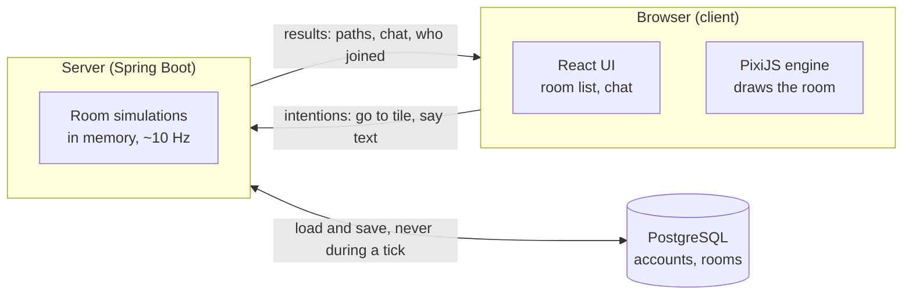

# Architecture

open-iso-world is a small multiplayer game: players walk on an isometric tile grid, see each other move and chat. This page explains how the pieces fit together. The decisions behind them live in [`docs/adr/`](adr/).

## The big picture



The browser asks, the server decides, the database remembers. Live state (who is where, what was said) never touches the database.

Three rules shape everything else:

1. **The server has the last word.** The client only sends intentions ("go to this tile", "say this"). The server validates them, decides what happens and tells everyone.
2. **The server thinks in grid coordinates.** Tiles are `(x, y)`. Isometric projection and screen pixels exist only in the client's `engine`.
3. **One protocol.** Every message is defined once in `protocol/` as JSON Schema. TypeScript types and Java records are generated from it, so client and server can't drift apart.

## A move, end to end

```text
1. Player clicks a tile        engine/input turns the click into (x, y)
2. Client sends intention      { "type": "moveTo", "seq": 12, "payload": { "x": 4, "y": 7 } }
3. Server queues the command   net puts it in the room's command queue
4. Next tick (~100 ms)         core rate-limits, validates the tile, runs A* around blocked tiles
5. Server broadcasts the path  { "type": "path", "payload": { "playerId": "...", "tiles": [{ "x": 3, "y": 7 }, { "x": 4, "y": 7 }] } }
6. Every client animates it    game interpolates tile by tile, engine draws it depth-sorted
```

The server sends the **whole path once**, not a position every tick. The first tile is where the player starts, so a client that drifted out of sync can realign. Clients animate on their own, which keeps traffic small and movement smooth.

## Connecting

```text
POST /api/tickets   →  { "ticket": "…" }        (single use, expires in seconds)
WS   /ws?ticket=…   →  hello { protocolVersion } → welcome + roomState
```

Every player gets a ticket first, guests included. Today the server issues it to an anonymous guest. From v0.3 it can also issue one to a logged-in account. The WebSocket side doesn't change, and access tokens never appear in URLs or logs. The ticket is part of the REST API, not of the message protocol.

If the client declares a protocol version the server doesn't support, the server answers with an `error` (`unsupportedProtocolVersion`) and closes the connection.

## Protocol

Every message shares one envelope:

```json
{ "type": "moveTo", "seq": 12, "payload": { "x": 4, "y": 7 } }
```

- `type` names the message, in camelCase.
- `seq` counts the sender's own messages on this connection, starting at 1. Each side keeps its own counter.
- `payload` is specific to each message.

**Frames.** The server sends the events of one tick together: each WebSocket frame from the server is a JSON array of envelopes, in the order they happened. There is no separate batch message. The client always sends a single envelope per frame.

```json
[
  { "type": "playerJoined", "seq": 7, "payload": { "player": { "playerId": "p-2", "position": { "x": 1, "y": 1 } } } },
  { "type": "path", "seq": 8, "payload": { "playerId": "p-1", "tiles": [{ "x": 3, "y": 7 }, { "x": 4, "y": 7 }] } }
]
```

| Message        | Direction       | Payload                                                 |
|----------------|-----------------|---------------------------------------------------------|
| `hello`        | client → server | `protocolVersion`                                       |
| `moveTo`       | client → server | `x`, `y`                                                |
| `welcome`      | server → client | `playerId` (the receiving player's own id)              |
| `roomState`    | server → client | `roomId`, `width`, `height`, `blocked` tiles, `players` |
| `path`         | server → client | `playerId`, `tiles` (starting with the current tile)    |
| `playerJoined` | server → client | `player`                                                |
| `playerLeft`   | server → client | `playerId`                                              |
| `error`        | server → client | `code`, `message`, optional `refSeq`                    |

Shared types:

- A **tile** is always `{ "x": …, "y": … }`, with integers ≥ 0. Whether a tile lies inside the room is checked by the server, because it depends on the room.
- A **player** is `{ playerId, position, path? }`. The optional `path` holds the tiles still to walk, so someone who just joined sees who is moving.
- A **playerId** is an opaque string that clients never interpret.

`error.refSeq` points to the client message that caused the error. The first codes are `unsupportedProtocolVersion`, `invalidMessage`, `invalidTile` and `rateLimited`.

How the schemas are organised in `protocol/`:

- **One schema file per message, describing its payload.** A small metadata block at the top, `x-message`, names the message `type` and its `direction` (who sends it: `client` or `server`).
- **One envelope schema.** It defines `{ type, seq, payload }` once, so the server can check any incoming frame before it knows the type, then validate the payload against the schema that `x-message` links to that type.
- **Shared types** live in one common schema.
- **Schemas are closed** (`additionalProperties: false`). The server rejects any field it doesn't expect.

**Versioning.** Protocol versions are integers, starting at 1. One file in `protocol/` defines two of them:

- `current` is the version the server and the client speak today.
- `minSupported` is the oldest version the server still accepts.

The server accepts any `hello` whose `protocolVersion` lies between `minSupported` and `current`, and answers anything else with `unsupportedProtocolVersion`. `current` only goes up for a breaking change, and adding a new message doesn't bump it. `minSupported` goes up when the server stops handling an old version. Today both are 1.

`hello` accepts any version ≥ 1 on purpose: a client with the wrong version still gets a clear error instead of a rejected message.

## Server

```text
app  ──►  net  ──►  core  ◄──  persistence
 │                   ▲              ▲
 └───────────────────┴──────────────┘
```

| Module        | What it does                                                    | Knows about           |
|---------------|-----------------------------------------------------------------|-----------------------|
| `core`        | Rooms, grid, pathfinding, tick loop, chat rules                 | Plain Java only       |
| `net`         | WebSocket sessions, decoding messages into room commands        | `core`, protocol      |
| `persistence` | JPA entities, repositories, Flyway migrations                   | `core`, database      |
| `app`         | Spring Boot wiring, configuration, REST, security               | Everything            |

`core` has no Spring, no JPA and no I/O. When it needs something from outside, such as loading a room, it declares an interface that `net` or `persistence` implements. That keeps the game logic easy to read and to unit-test. ArchUnit enforces these arrows.

### One room, one simulation

Each active room lives in memory with its own command queue and a tick loop at ~10 Hz:

```text
every tick:
  advance walking players  →  drain command queue  →  validate & apply  →  send one batch to the room
```

A room runs on one thread at a time, so game state needs no locks. The tick loop **never waits on the database**: anything slow happens outside it and comes back as a command.

#### Inside `core`

| Package     | What it holds                                                                                 |
|-------------|-----------------------------------------------------------------------------------------------|
| `core.grid` | `Tile`, `Grid` (size and blocked tiles) and `Pathfinder` (A*). No players, no time            |
| `core.room` | `Room` (the simulation), `RoomLoop` (the clock and the command queue), commands and events    |

**Commands in, events out.** `net` hands commands (`Join`, `Leave`, `MoveTo`) to `RoomLoop.submit` from any thread. Once per tick, `RoomListener.onTick` receives all the events of that tick, in order. Each event says who receives it: everyone, one player, or everyone but one. Who sees what is a game rule, so `core` decides it and `net` only groups the events by session.

**A grid is a drawing.** `.` is floor and `#` is blocked; the first row is `y = 0`:

```java
Grid grid = Grid.parse(
        "......",
        "..##..",
        "......");
```

**Movement rules.**

- Players move in 8 directions, and a diagonal step never cuts the corner of a blocked tile.
- A* is deterministic: the same click always gives the same path.
- One step takes 5 ticks, so players walk 2 tiles a second, diagonals included. Steps produce no events: clients animate the path they received.
- A new goal while walking starts from the tile the step in progress reaches, so nobody jumps back.
- Players don't block each other.
- A tile outside the room, blocked or unreachable is refused; the protocol reports all three as `invalidTile`.

**Rate limit.** Each player has a bucket of 5 moves that refills by one every 2 ticks, about 5 moves a second. Every `moveTo` costs one, even a refused one.

**Time is counted in ticks**, not milliseconds, so game rules are tested tick by tick, without clocks or threads. `RoomLoop` runs on a scheduler owned by `app`, which can run many rooms.

## Client

```text
ui  ──►  game  ──►  net
 └──►  engine ──►  game
```

| Layer    | What it does                                               | Only place that uses |
|----------|------------------------------------------------------------|----------------------|
| `net`    | WebSocket and REST                                         | the network          |
| `game`   | Room state, players, path interpolation (pure TypeScript)  | —                    |
| `engine` | Isometric math, rendering, camera, input                   | PixiJS               |
| `ui`     | Room list, room screen, chat                               | React                |

A single React component mounts the engine. After that, PixiJS draws every frame on its own and React never re-renders per frame. eslint-plugin-boundaries enforces these arrows.

Inside `engine`:

- `iso/` converts grid ↔ screen and computes depth. It's pure math, with no PixiJS.
- `scene/` holds **one** depth-sorted layer for avatars and furniture. Splitting them would break the sorting.
- `sprites/` contains the views for tiles, avatars and furniture.
- `camera/` handles integer zoom, pan and `roundPixels`, so pixel art stays sharp.
- `input/` turns a click into a tile.

## What lives where

| Data                         | Where      | Why                                    |
|------------------------------|------------|----------------------------------------|
| Positions, presence, chat    | Memory     | Changes every tick and is gone on restart |
| Guests                       | Memory     | No account, nothing to keep            |
| Rooms and layouts (v0.3)     | PostgreSQL | Must survive a restart                 |
| Accounts, refresh token hashes (v0.3) | PostgreSQL | Must survive a restart       |

## Security in one paragraph

Never trust the client. The server checks every coordinate (inside the room, not blocked), every room access and every chat message, and rate-limits commands per player (about 5 moves per second). Secrets live in `.env`, which is never committed. Passwords are hashed with BCrypt or Argon2, and only hashes of refresh tokens are stored.

## Extending

- **New message:** add a schema in `protocol/`, run `pnpm protocol:gen`, then handle it in the server and the client in the same PR. A breaking change bumps the protocol version.
- **New game rule:** put it in `core`, behind the tick loop, with a unit test.
- **New client:** see `examples/bot`, a headless client that uses the same protocol without React or PixiJS.
